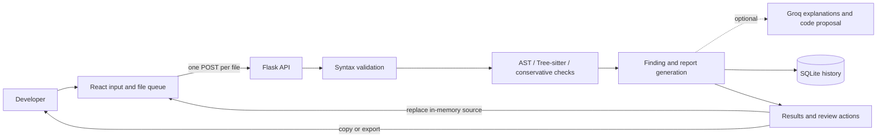

# FutureBug — Project Guide

> **Purpose:** FutureBug is a local-first code-review prototype that identifies maintainability signals, explains why they may matter, and can propose an improved source file for a developer to review. It is a review aid—not a compiler, type checker, security scanner, or guarantee that code is bug-free.

## 1. At a glance

FutureBug is a single-page React application backed by a Python Flask API. The browser manages source input and review interactions; Flask runs language analysis, generates ticket-style findings, and stores analysis records in SQLite. Groq is optional and is used only when `GROQ_API_KEY` is configured.



## 2. Main features

### Source intake and batch safety

- Paste code or add multiple files using the file picker, drag-and-drop, or folder upload.
- File extensions determine the language for uploaded files; pasted snippets use a best-effort language guess with the language picker as fallback.
- Folder uploads include supported source extensions and retain each file’s relative path for display.
- Batch limits: **20 supported files**, **2 MB total**, and **200 KB per file**.
- Files are analyzed sequentially. The loading screen reports progress and provides a cancel button. Completed analyses remain visible after cancellation; the active interrupted file and files never started are distinguished.

Accepted extensions: `.py`, `.pyw`, `.js`, `.mjs`, `.cjs`, `.jsx`, `.java`,
`.ts`, `.tsx`, `.c`, `.h`, `.cc`, `.cpp`, `.cxx`, `.hpp`, `.hxx`, `.go`,
`.rs`, `.php`, `.rb`, and `.dart`.

### Analysis and findings

- Reports include a title, explanation, severity, evidence, affected lines, potential scenario/impact, recommendation, and a suggested fix where available.
- Maintainability observations are classified as **possible risks**; a smell is not proof of a runtime defect.
- Parser diagnostics are shown separately. They mean a parser observed an unexpected or missing syntax node; they are not compiler or type-check results.
- Results are available per file, with line highlighting and a copy/export action for the complete Markdown report.

### Improved-code review

- If findings exist and `GROQ_API_KEY` is configured, the optional Groq request can provide clearer report text, a change summary, and a complete proposed source file.
- Full-file proposals are only attempted for source files up to **16 KB**. The proposal is syntax-checked before the UI displays it; syntax validation does not prove behavioral correctness.
- The developer can choose **Use in preview only**, **Replace current source**, or **Keep original code**.
- **Replace current source** returns to the input screen and updates the pasted snippet or selected queued-file copy held in FutureBug so it can be reviewed and analyzed again. It does **not** overwrite the original file on disk.
- **Export improved code** downloads a separate `.improved` file. Proposal generation never auto-applies changes.

## 3. Technology and analysis behavior

| Area | Implementation |
| --- | --- |
| Frontend | React 19, Vite, JavaScript/JSX, CSS, `react-syntax-highlighter` |
| Backend API | Python 3.11+ and Flask, with Flask-CORS |
| Persistence | Flask-SQLAlchemy and SQLite |
| Python analysis | Python’s built-in `ast` module |
| JavaScript/JSX syntax | Tree-sitter JavaScript grammar; smell checks remain conservative text-based signals |
| Java, TypeScript, C/C++, Go, Rust, PHP, Ruby, Dart | Tree-sitter grammar parsing and structural checks |
| Optional AI | Groq OpenAI-compatible chat completions API; default model `llama-3.3-70b-versatile` |

### Current smell checks

- **Long function:** function bodies that exceed the configured 12-line threshold (AST, Tree-sitter, or conservative JavaScript text scan depending on language).
- **Duplicate logic:** repeated non-trivial source lines (currently implemented for Python and JavaScript).
- **Complex conditional:** conditionals with multiple Boolean operators/branches.
- **Bare exception / empty catch:** Python bare `except` clauses and parameterless JavaScript `catch {}` bodies that appear empty.
- **Unused import:** Python imports whose names are not found in the local AST name-use scan.

These are intentionally conservative signals. Text-based checks can be affected by nested syntax, strings, comments, or formatting. An apparent unused import may be used dynamically, and repeated lines do not prove duplicated behavior.

Tree-sitter grammar packages may need to download and cache a grammar the first time a language is used. The code itself is parsed locally; source is not sent to Tree-sitter.

## 4. Repository structure

```text
Futurebug-master/
├── index.html                  # HTML shell, font loading, theme pre-application
├── package.json                # Frontend dependencies and npm scripts
├── package-lock.json
├── vite.config.js
├── setup.bat                   # Windows dependency and virtual-environment setup
├── run.bat                     # Starts backend/frontend and opens the app
├── README.md                   # Getting started and concise project documentation
├── PROJECT_GUIDE.md            # This guide
├── src/
│   ├── main.jsx                # React root and global stylesheet import
│   ├── App.jsx                 # Screen state, batch orchestration, API calls, theme
│   ├── App.css                 # App layout and component styling
│   ├── index.css               # Design tokens, global reset, theme variables
│   ├── mockData.js             # Language/file mappings, samples, theme helpers
│   └── components/
│       ├── InputScreen.jsx     # Editor, upload/folder queue, drag-and-drop, limits
│       ├── LoadingScreen.jsx   # Progress and cancellation UI
│       ├── ResultsScreen.jsx   # Findings, proposal review, code/report export
│       ├── BugReportCard.jsx   # Individual issue/finding card
│       └── icons.jsx           # Inline SVG icons
└── backend/
    ├── app.py                  # Flask endpoints, validation, persistence
    ├── models.py               # Analysis and BugReport database models
    ├── requirements.txt        # Python dependencies
    ├── futurebug.db            # Local SQLite database (created/used at runtime)
    ├── analyzer/
    │   ├── smell_detector.py  # AST/Tree-sitter parsing and smell checks
    │   └── smell_rules.py     # Finding names, severities, and thresholds
    ├── generator/
    │   └── bug_report_generator.py # Report templates, optional Groq and proposals
    ├── prompts/
    │   └── smell_to_scenario.json # Finding-to-report text templates
    └── js_validator.cjs       # Legacy Node validator; current JavaScript API validation uses Tree-sitter
```

## 5. Request and analysis flow

1. The input screen validates file count and byte limits and creates a source list.
2. `src/App.jsx` sends each file sequentially to `POST /analyze`, including its code, language, and filename.
3. Flask validates the request and source size. JavaScript/JSX syntax is checked with the Tree-sitter JavaScript grammar; Python and the other structural-analysis languages use their configured parser paths.
4. The analyzer returns possible-risk smells and, where applicable, parser diagnostics.
5. The report generator creates local report text. If configured, Groq can enrich the report and propose a complete improved file. The candidate is validated and withheld if invalid; no candidate is written to the uploaded source.
6. Flask stores the source, language, count, and report metadata in `backend/futurebug.db`, then returns results to the UI.
7. The user reviews findings and any proposal. Exporting creates a separate download; replacing current source updates only the application’s in-memory working copy.

## 6. Backend API

Base URL by default: `http://127.0.0.1:5000`.

### `GET /health`

Returns service status, for example:

```json
{ "status": "ok", "service": "futurebug" }
```

### `POST /analyze`

Request body:

```json
{
  "code": "function example() { return true; }",
  "language": "javascript",
  "filename": "example.jsx"
}
```

Supported language identifiers: `python`, `javascript`, `java`, `typescript`, `c`, `cpp`, `go`, `rust`, `php`, `ruby`, and `dart`.

The response contains `results`, `smells_detected`, `diagnostics`, `improved_code`, `improvement_summary`, and `improvement_message`. Proposal fields may be empty or explain why a proposal is unavailable (for example, missing Groq credentials, no findings, source above 16 KB, provider failure, or invalid generated syntax). Each result includes a database-assigned ticket plus its finding/report fields.

### History endpoints

- `GET /history` — list stored analyses.
- `GET /history/<id>` — retrieve one analysis and its stored reports.
- `DELETE /history/<id>` — delete an analysis and its related reports.

The SQLite database is local to the backend, but it stores submitted source code and report data. Protect or remove `backend/futurebug.db` as appropriate for the code you analyze.

## 7. Setup and development

### Windows quick start

1. Install **Python 3.11 or newer**, Node.js, and npm.
2. Run `setup.bat` once to create `backend/.venv`, install Python requirements, and install npm dependencies.
3. Optionally set Groq credentials in the same shell/session before starting:

   ```powershell
   $env:GROQ_API_KEY = 'your-api-key'
   # Optional:
   $env:GROQ_MODEL = 'llama-3.3-70b-versatile'
   ```

4. Run `run.bat`. The backend defaults to port 5000 and Vite to 5173; the frontend port can advance if occupied. `BACKEND_PORT` and `FRONTEND_PORT` can be set to override defaults.

### Development commands

```bash
npm install
npm run dev       # Vite development server
npm run lint      # Oxlint
npm run build     # Production build
npm run preview   # Preview production build
```

For backend setup, create and activate a Python virtual environment, then install `backend/requirements.txt`. The backend can be launched with `python app.py --port 5000` from `backend/`; the `PORT` environment variable is used if `--port` is not specified.

## 8. Privacy, safety, and current limitations

- Files are read locally in the browser. They are sent to the local FutureBug backend only when analysis starts.
- With Groq enabled, submitted source and findings are sent to the configured external provider. Only submit code you are authorized to share. Keep API keys out of source control.
- Proposals are generated text, not trusted patches. Review logic, run tests, and use version control before adopting them in a real codebase.
- “Syntax checked” means the configured parser accepted the candidate; it does not mean the code compiles, type-checks, or preserves behavior.
- Static analysis has false positives and false negatives. It is not a substitute for language-specific compilers, linters, tests, security tools, or human review.
- Frontend lint/build checks have been run during development. Backend end-to-end behavior should be verified on a machine with a working Python 3.11+ environment and installed requirements.
